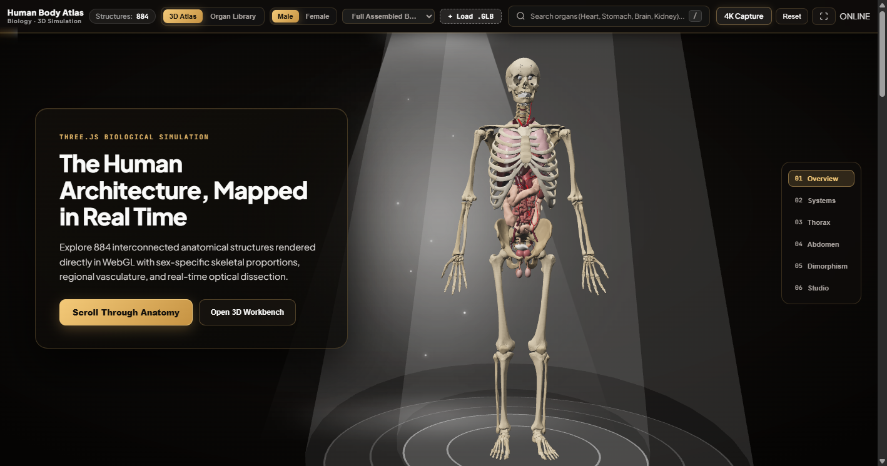
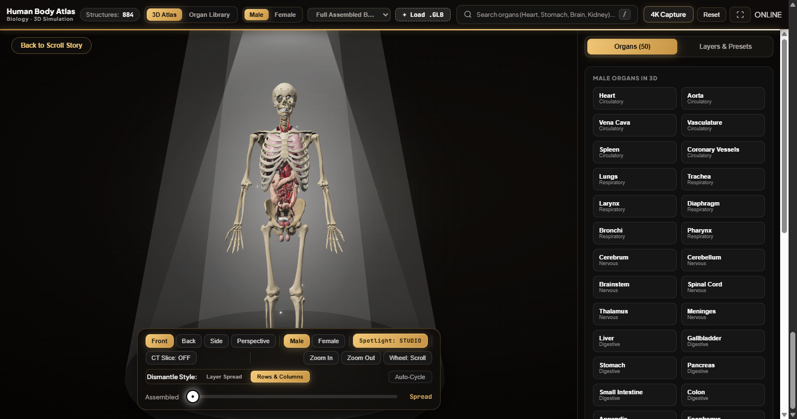
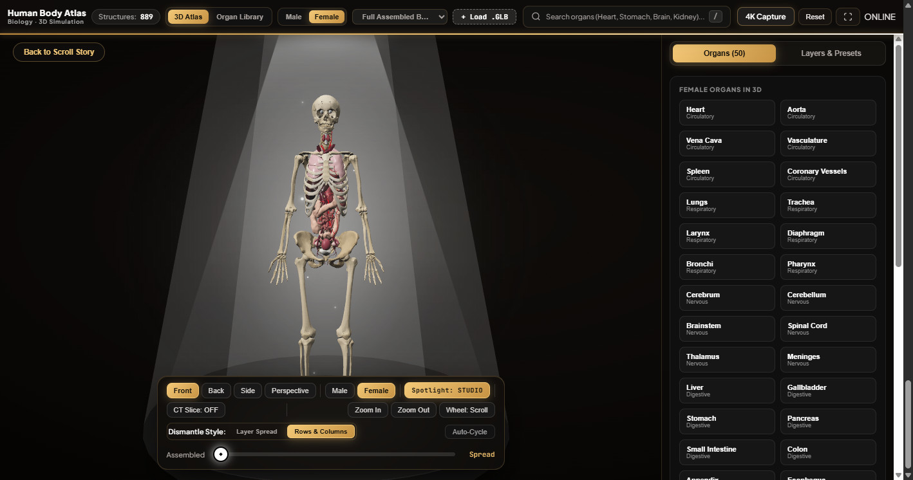
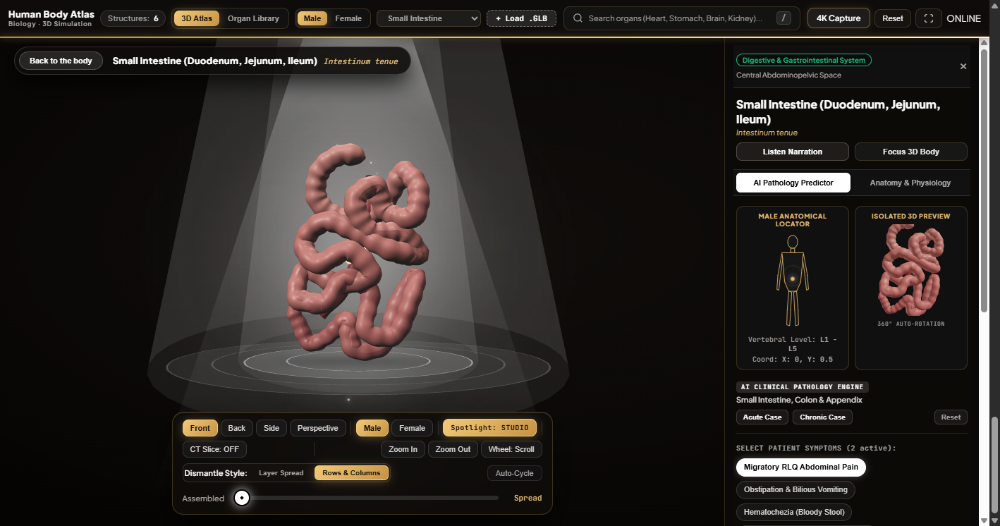
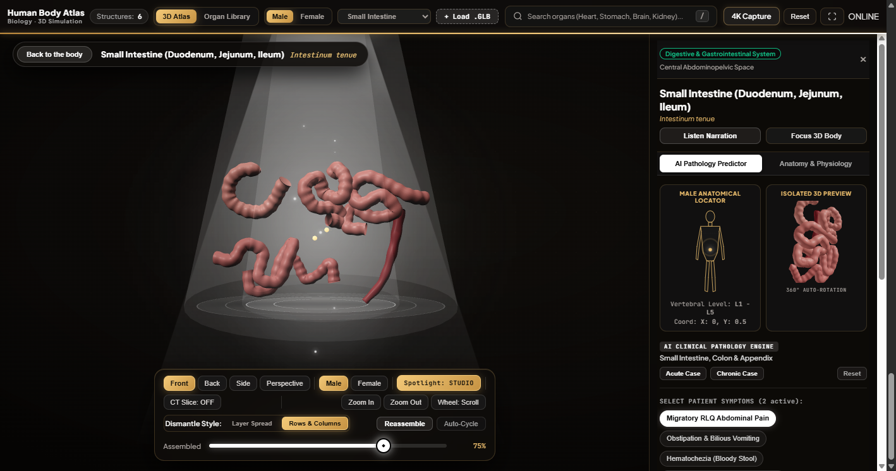

# Body Lab 3D — Human Body Atlas

**Live Interactive Demo:** [https://body-lab-3d.netlify.app](https://body-lab-3d.netlify.app)



Interactive WebGL human anatomy explorer built with **React**, **Three.js**, **React Three Fiber**, and **Drei**. Features a criss-cross aperture opening sequence, smooth scroll-driven 3D camera & layer choreography, a full dissection workbench, CT/MRI cross-section slicing, and sex-dimorphic Male & Female Organ Libraries.

## Showcase Screenshots

| Whole Body Dissection (Male) | Female Morphology (`889` Structures) |
| :---: | :---: |
|  |  |

| Cohesive Small Intestine (6-Part Model) | Interactive Dismantle (`Rows & Columns`) |
| :---: | :---: |
|  |  |

## Features

- **Scroll-Driven Three.js Choreography**: Smoothly transitions through Overview, Structural Systems, Thoracic Core, Abdominal Viscera, Sexual Dimorphism, and the centered Interactive Dissection Studio (`Layer Spread` and `Rows & Columns`).
- **Male & Female Dimorphic Morphology**: Sex-specific skeletal proportions (pelvis, ribcage, shoulder girdle, mandible), laryngeal asymmetry, and reproductive organ sets (`Testes`, `Prostate`, `Uterus`, `Ovaries`, `Fallopian Tubes`).
- **Multi-Planar CT / MRI Slicer**: Interactive Axial, Coronal, and Sagittal clipping planes with reversible cut direction and depth control.
- **Dual Organ Library & Schematics**: 50 anatomical targets with SVG regional schematics, system filtering, `Dismantle & Inspect in 3D`, and `View in Body Atlas` camera focusing.
- **Custom `.GLB` Inspector & 4K Capture**: Drag-free OrbitControls, preset viewpoints (`Front`, `Back`, `Side`, `Perspective`), Studio / Surgical / Cyber / X-Ray spotlight modes, audio narration, and high-res PNG capture.

## Development

```bash
npm install
npm run dev
```

## Production Check

```bash
npm run lint
npm run build
```

## 3D Dataset Attributions

Open-access scientific datasets (`Z-Anatomy`, `DBCLS BodyParts3D`, `NIH HuBMAP`, and `Allen Brain Atlas`) are documented in [public/CREDITS.md](public/CREDITS.md).
